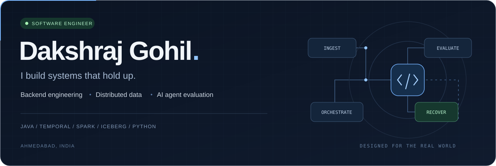
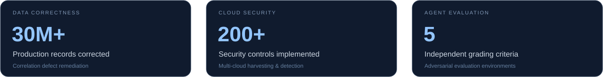

  

  
  &nbsp;
  
  &nbsp;
  

### Systems that recover. Evaluations that reveal.

I'm **Dakshraj**, a Software Engineer at **Crest Data**, working on backend services, distributed ingestion, and data platforms. I build the machinery behind reliable engineering insights: durable workflows, resilient connectors, efficient queries, and systems that recover when something breaks.

I also design **adversarial evaluations for LLM agents**—studying behavior, closing reward-hacking shortcuts, and testing whether an agent fixed a root cause or only changed what a grader can see.

  

### Selected engineering work

| Area | What I've built | Explore |
| :--- | :--- | :--- |
| **Distributed data platforms** | Temporal-orchestrated ServiceNow and Bitbucket ingestion; Spark + Iceberg transformations; engineering delivery metrics and SQL performance improvements. | [Data systems →](work/data-systems.md) |
| **API simulation & developer tooling** | A stateful mock server built from OpenAPI and Postman specifications, with conditional responses, negative scenarios, and MCP-assisted endpoint generation. | [API tooling →](work/api-simulation.md) |
| **Cloud integrations & security** | A GCS-to-Kafka connector and multi-cloud harvesting and detection logic for 200+ security controls across AWS, GCP, Azure, and StackIt. | [Cloud engineering →](work/cloud-security.md) |
| **AI agent evaluation** | Adversarial environments, process-based graders, behavioral trace analysis, and defenses against specification gaming. | [Evaluation methodology →](work/agent-evaluation.md) |

These write-ups summarize professional and independent work. The linked pages describe the engineering; they do not contain employer source code.

### My engineering toolkit

| Layer | Technologies & practice |
| :--- | :--- |
| **Backend** | Java · Spring Boot · REST APIs · Microservices · C++ |
| **Workflows & data** | Temporal · Apache Spark · Apache Iceberg · Kafka |
| **Storage & search** | PostgreSQL · SQL optimization · Redis · Elasticsearch |
| **Cloud & delivery** | GCP · Docker · Jenkins · Git · AWS Secrets Manager & KMS |
| **Cloud integration** | OAuth 2.0 · Hibernate / JPA · Pagination · Incremental ingestion · Rate-limit handling |
| **AI & evaluation** | Python · LLM agent benchmarks · Grader design · Behavioral trace analysis · MCP · RBAC |
| **Quality** | JUnit · Python test suites · Integration testing · Failure-mode analysis |

### Problems I like working on

- **Durable execution:** workflows that retry, checkpoint, and resume without silently losing data.
- **Data correctness at scale:** schema evolution, correlation defects, and expensive metric queries.
- **Trustworthy agents:** evaluations that reward durable fixes and resist shortcuts.
- **Useful developer tools:** making APIs easier to simulate, integrate, and test under failure.

### A little more about me

**B.Tech in Computer Science · CHARUSAT · 9.35/10 CGPA** 
NPTEL Operating System Fundamentals **Top 5%** · Design and Analysis of Algorithms · **SSIP grant recipient** for the student innovation project *Bull Run*.

Earlier, I worked on an airline booking application at **Prolog Infotech** and a tiles marketplace with a camera preview feature at **Raven Technolabs**.

---

  <b>Building something that needs to work beyond the happy path?</b> 
  <a href="mailto:dakshrajsinhgohil22@gmail.com">Let's talk engineering.</a>

